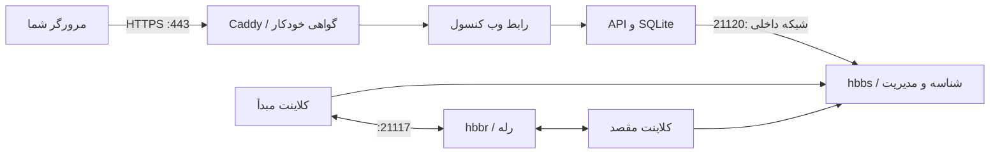
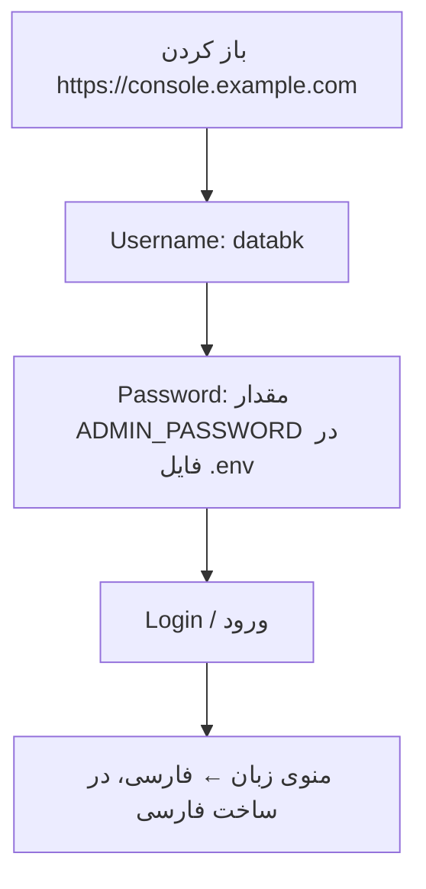
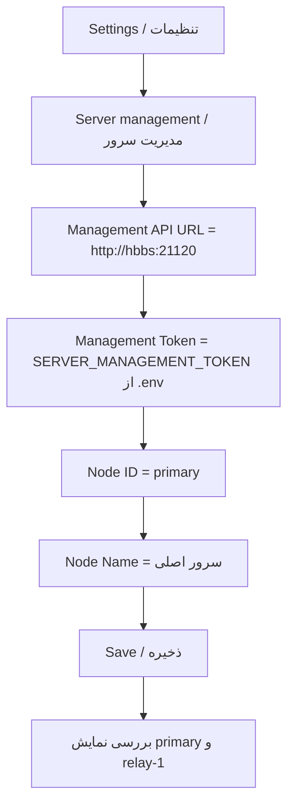
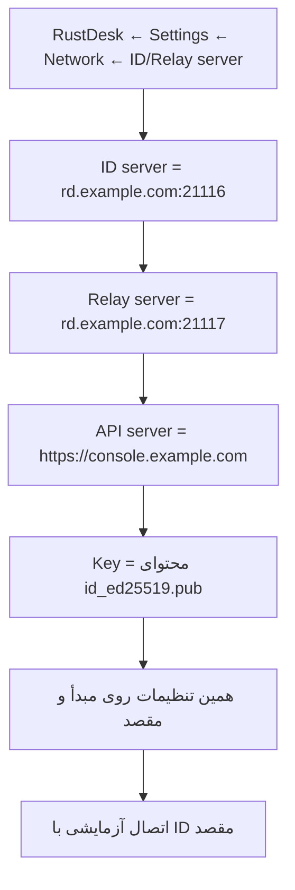
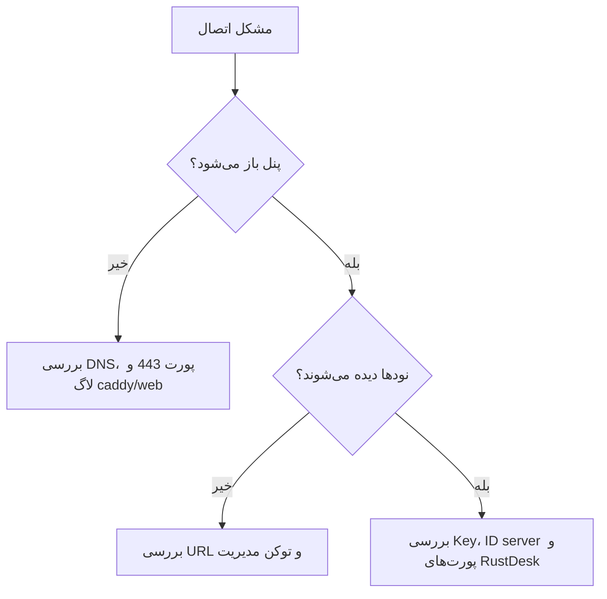

# راهنمای تصویری راه‌اندازی

[راهنمای اصلی](README-FA.md) · [دستورهای نصب و نگهداری](enhancements-FA.md)

شکل‌های زیر **شماتیک آموزشی** هستند، نه اسکرین‌شات پنل. نام فیلدهای انگلیسی برای تطبیق با نسخهٔ اصلی کنار توضیح فارسی آمده است.

## مسیر اتصال

HTTPS مربوط به پنل است. برای اتصال RustDesk، پورت‌های شناسه و رله نیز لازم‌اند.

## مرحلهٔ اول: ورود به پنل

رمز و توکن واقعی را در تصویر راهنما یا پیام عمومی قرار ندهید. رمز تصادفی با این دستور دیده می‌شود: `sudo cat /opt/rustdesk-console-compose/.env`.

## مرحلهٔ دوم: معرفی سرور در پنل

آدرس `http://hbbs:21120` داخل Docker استفاده می‌شود؛ قرار نیست آن را در مرورگر باز کنید. شناسهٔ نود اصلی را `relay-1` نگذارید.

## مرحلهٔ سوم: تنظیم دو کلاینت

کلید را با `sudo cat /opt/rustdesk-console-compose/data/server/id_ed25519.pub` بخوانید. فایل بدون پسوند `.pub` خصوصی است و نباید در کلاینت وارد شود.

## مسیر انتخاب هنگام خطا

